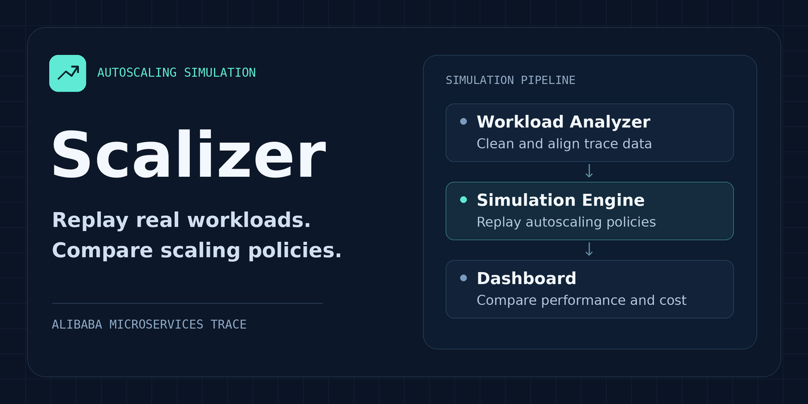

# Scalizer

Simulate microservice autoscaling with Alibaba workload traces and compare policies by performance and cost.



## Getting started

Clone the project repository:

```bash
git clone https://github.com/Berserk-hub150/Scalizer.git
cd Scalizer
```

Scalizer is in development. The implementation and installation instructions are pending publication.
